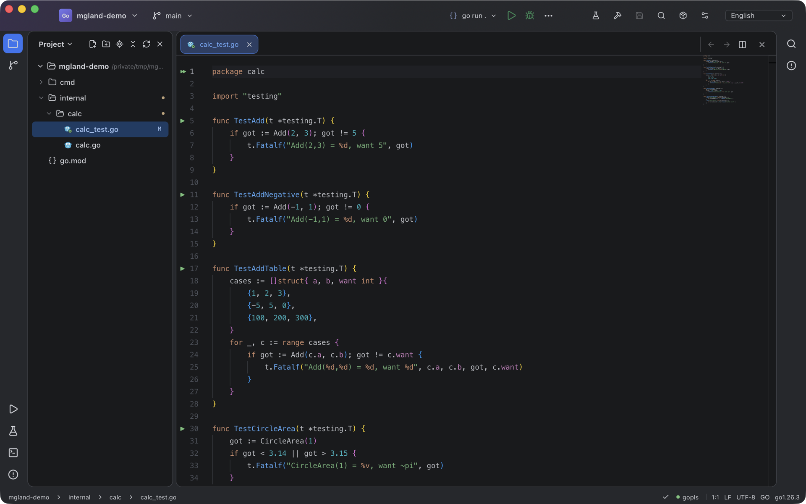
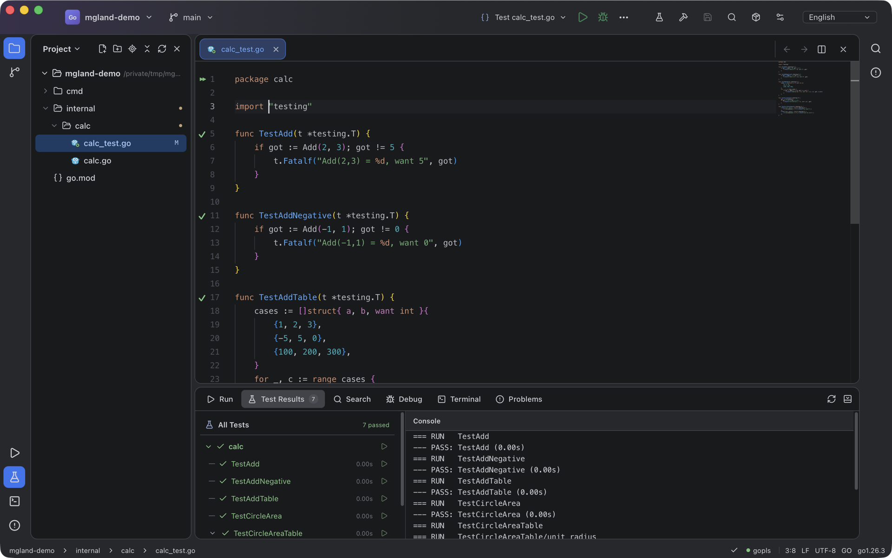
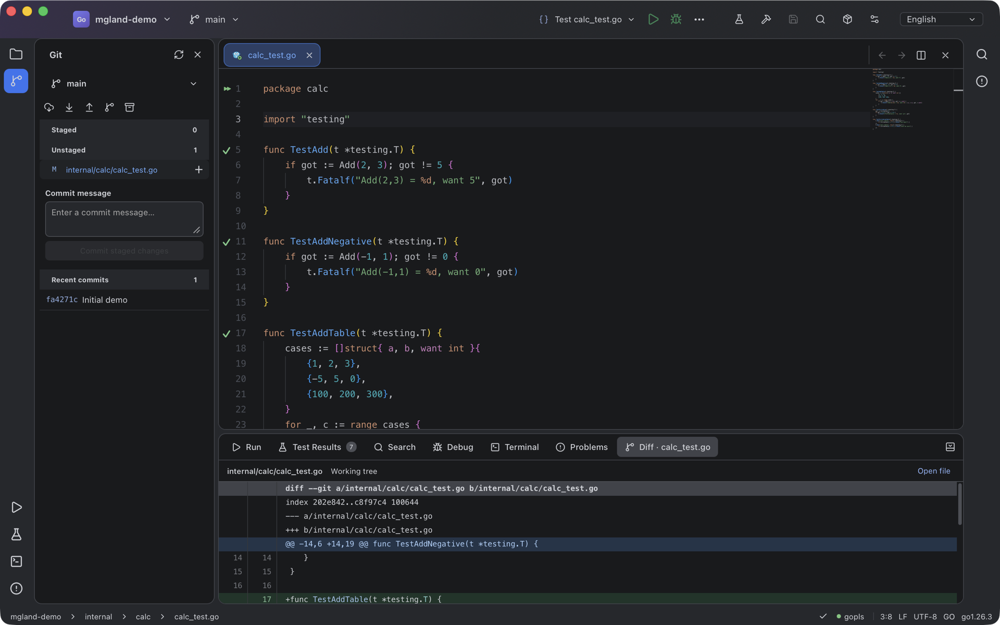
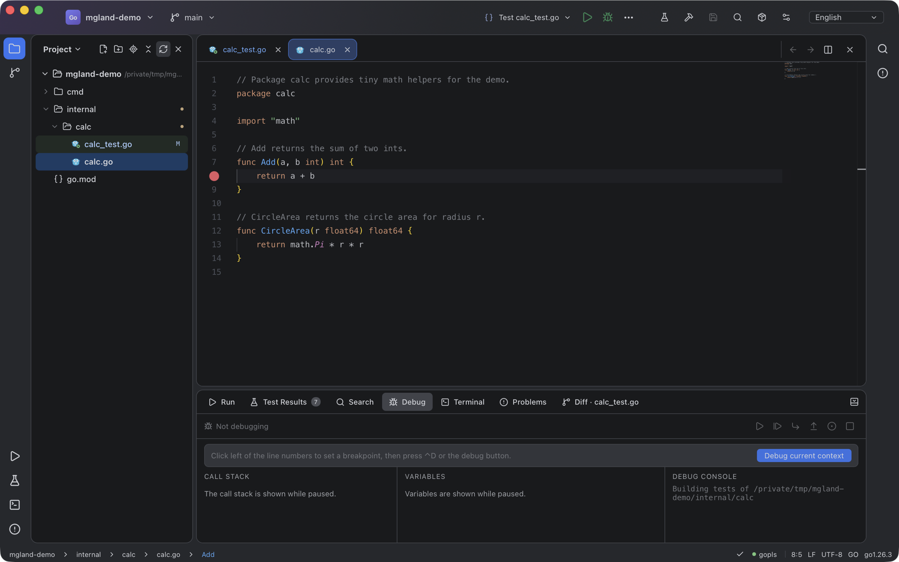
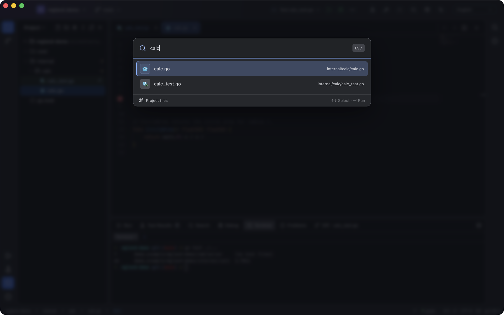
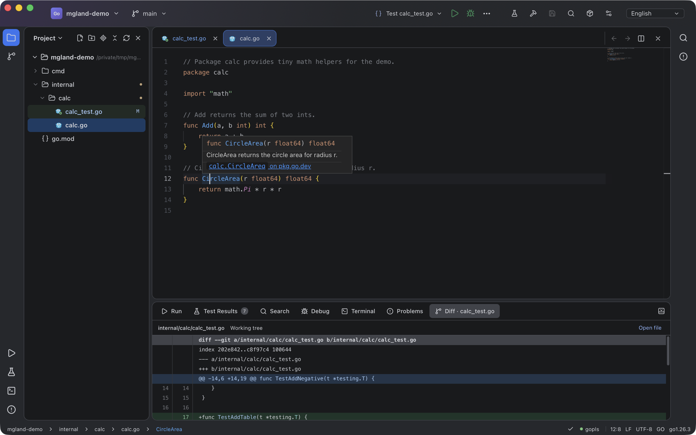
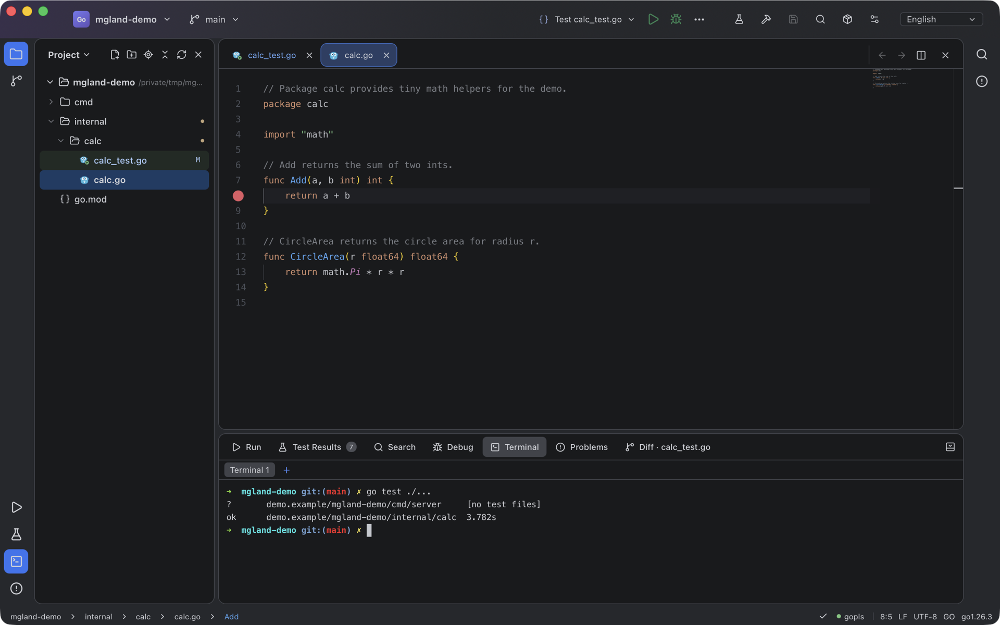

<div align="center">

# GoMavo

**A focused, native Go IDE for macOS, powered by the Go toolchain.**

Tauri 2 · React 19 · Monaco Editor · `gopls` · Delve



**English** | [简体中文](README.zh-CN.md)

</div>

GoMavo is a focused Go IDE for macOS: one project per window, familiar macOS keyboard shortcuts, and the official Go toolchain underneath — `gopls` provides language services, Delve handles debugging, and the `go` CLI runs and tests your code. Everything runs locally: no accounts, no telemetry, no cloud.

## Features at a glance

- **Fast editing** — Project tree colored by Git status, tabbed editing, breadcrumb navigation, Double-Shift search everywhere, Go to File (⌘⇧O), Find Action (⌘⇧A), and back/forward navigation that restores cursor and scroll position.
- **Real Go language services** — completion, hover documentation, diagnostics, semantic highlighting, go to definition (Go SDK and module cache open as read-only tabs), and format-current-file, all via `gopls`.
- **Built-in Delve debugger** — click the gutter or press F9 to toggle breakpoints, and ⌃D debugs the context under the cursor; call stack, variables, and a debug console live in the Debug tool window.
- **Integrated testing** — quick-run icons in the gutter of `_test.go` files, ⌃R runs the test under the cursor or the whole file, results appear as a per-case tree with single-test rerun, and test coverage highlighting comes from `go test -cover`.
- **Git tool window** — branch switching, staged/unstaged changes with unified diffs, commit, recent history, per-file history, and line-by-line blame.
- **Local-first everything** — an integrated PTY terminal, `go mod tidy/download`, `go vet`, `go fmt`, `.editorconfig` support, and a native plugin system. UI available in English and 简体中文.

<table>
  <tr>
    <td width="50%"><p align="center"><sub>Run tests from the gutter; the results tree supports per-case reruns</sub></p></td>
    <td width="50%"><p align="center"><sub>Git tool window with unified diff and commit box</sub></p></td>
  </tr>
  <tr>
    <td width="50%"><p align="center"><sub>Breakpoints and the Delve-backed Debug tool window</sub></p></td>
    <td width="50%"><p align="center"><sub>Go to File overlay (⌘⇧O)</sub></p></td>
  </tr>
  <tr>
    <td width="50%"><p align="center"><sub>Hover documentation from gopls</sub></p></td>
    <td width="50%"><p align="center"><sub>Integrated terminal on a real PTY</sub></p></td>
  </tr>
</table>

## Requirements and getting started

Building from source requires Node.js, pnpm, Rust/Cargo, and a Go toolchain, plus the Tauri 2 system dependencies for your OS; the build scripts compile `gopls` and `dlv` (Delve) automatically before packaging and bundle them into the package. Running the packaged app only requires a Go toolchain and Git on the machine — make sure `go version` and `git --version` work; no separate `gopls` install is needed.

The app prefers the bundled `gopls` and `dlv` and falls back to `PATH`, `GOBIN`, `GOPATH/bin`, and similar locations. You can still install or upgrade `gopls` from the status bar at the bottom right after opening a project; that step needs access to the Go module proxy.

```bash
pnpm install
pnpm tauri dev
```

After launch, click the project name at the top left to choose "New Window", "New Project", or "Open Project"; the macOS File → New Window, File → New → Project, and File → Open Project menu items provide the same entries, and the Dock icon's right-click menu can create a new window. New windows show the project picker, where you can open an existing project or create a new Go project; the previous project is not reopened automatically. Creating a project makes a folder in the parent directory you choose and runs `go mod init`. Opening or creating another project from an existing window spawns an independent window, and each window keeps its own project state. The app restores the last opened directory at startup. Settings open from the macOS app menu (Settings… or ⌘,). Run `pnpm tauri build` to produce the desktop package. `pnpm dev` only previews the browser UI; files, Go commands, Git, the PTY terminal, and `gopls` depend on the Tauri desktop backend.

## Implemented workflows

| Area | Current capabilities and entry points |
| --- | --- |
| Projects and files | Project tree browsing, locate current file, collapse all; file and directory context menus open, create, copy paths, rename, and delete, and can create a new `.editorconfig`; multi-tab editing and saving; file search. Binary files open as a read-only hex preview. ⌘S saves the current file and ⌘⌥S saves all; closing unsaved tabs or windows prompts, and saving checks whether the file changed on disk externally. |
| Go editing | `gopls` supplies completion, hover info, diagnostics, semantic highlighting, go to definition, and current-file formatting; the Problems panel locates diagnostics. ⌘B and ⌘-click on definition links open Go definitions outside the workspace as read-only tabs; scope covers the Go SDK, the module cache, and local modules from the Go configuration. Code navigation saves cursor and scroll position and returns via the editor tab bar's back/forward buttons or shortcuts. |
| Run and test | The top run configurations execute the project root package with `go run .`, the current file's package with `go run`, tests for all / the current package / a directory and subdirectories / a file, and `go build ./...`. Tests run with `go test -json -count=1` and show packages, test cases, and output in Test Results; rerun a single test or the most recent scope. Go source files can generate test stubs from the Project tree context menu, and the editor context menu generates stubs for the current method or whole file into a `_test.go` in the same directory; tests with the same name are skipped. The `package` line and Test, Example, Fuzz, and Benchmark declarations in `_test.go` get quick-run icons, and method gutters show the most recent run result. "Run with coverage" collects `go test -cover` data and highlights covered/uncovered code in the editor. Tasks can be stopped. |
| Debugging | Built-in Delve (DAP): click a source file's gutter or press F9 to toggle breakpoints; ⌃D debugs the context under the cursor (the test method, test file, or package); the Debug tool window provides the call stack (with frame switching), variable inspection, a debug console, and a stop button. |
| Go tools and modules | "More Go Actions" in the toolbar offers `go fmt ./...`, `go vet ./...`, `go mod tidy`, and `go mod download`; `go.mod`, `go.sum`, and `go.work` open and edit as text files. |
| Git | The Git tool window shows branches and staged/unstaged state; the Project tree and editor tabs color files by status. The Project tree file and editor context menus show a file's Git history, and clicking a commit shows its diff. You can also view the current text diff, stage/unstage, commit, and browse recent commits, and the editor context menu shows line-by-line Git blame. Local branches can be created and switched from the toolbar. Git features require the local Git CLI and an open Git repository directory. |
| Terminal | The Terminal tool window runs a shell in the project directory via xterm.js and a native PTY, with interactive input, resize handling, and restart after a session ends. |
| Search and commands | Double-Shift searches files and actions; there are also ⌘⇧O Go to File, ⌘⌥O Go to Symbol, ⌘⇧F Find in Files, and ⌘E Recent Files. Enabled plugin commands also appear in action search. |
| Bookmarks and local history | F3 toggles a bookmark on the current line; local edit history records changes per session and can show a diff per entry. |
| Plugins | In Settings → Plugins, pick a local `.gomavo-plugin` package or a JSON command manifest to import, enable/disable, and remove. Native plugins can register commands, Monaco completions, and hover providers; the JSON manifest only supports existing Go tasks or relative files inside the open project. See the [native plugin section](#gomavo-native-plugins) below and the two examples. There is no online marketplace yet. |
| Settings | The top gear icon, ⌘,, or the macOS app menu's Settings… opens settings; the left tree and search locate existing options, including compact mode, editor font size/line height/tab/minimap/wrapping, Project tree, Git auto refresh, terminal font size, UI language, keymap, and plugin management. Preferences persist in local app storage. The UI switches between Chinese and English; a few newer panels remain Chinese-only. |

Modified tabs are saved before Go tasks run. The default build is the Go CLI's `go build ./...`, whose output behavior follows the Go toolchain and may create files in the project directory. Only one Go task runs at a time.

## How it compares with GoLand

GoMavo is independently developed and is not affiliated with or endorsed by JetBrains. The comparison below describes workflows and features; GoMavo does not run JetBrains plugins. It uses `gopls`, Delve, and the `go` CLI.

GoLand is a trademark of JetBrains s.r.o. See the [JetBrains brand guidelines](https://www.jetbrains.com/company/brand/).

**GoMavo vs GoLand vs VS Code (Go extension)**

| | GoMavo | GoLand | VS Code + Go |
| --- | --- | --- | --- |
| Language engine | `gopls` (official LSP) | JetBrains' own Go engine | `gopls` |
| Debugger | Delve (bundled in the app) | Delve-based | Delve |
| Footprint | Native window + system WebView, no JVM | JVM-based (typically GBs) | Electron |
| Startup | Seconds, no JVM boot | Tens of seconds | Seconds |
| Refactoring | Basic (no rename/extract yet) | Full: rename, extract, inline, and more | Rename via `gopls` |
| Plugin system | Own `.gomavo-plugin` format | IntelliJ Marketplace (JVM) | VSIX marketplace |
| License | MIT (open source) | Free for non-commercial; paid subscription for commercial use | Free |

**Feature parity with GoLand** — an honest snapshot; ✅ done, ⚠️ partial, ❌ missing:

| Area | GoMavo | Notes |
| --- | --- | --- |
| Project tree, multi-window multi-project | ✅ | No GoLand project templates or multi-module workspace model ❌ |
| Editing: completion / hover / diagnostics / semantic highlighting / formatting | ✅ | Via `gopls`; no Quick Fixes or intention actions ❌ |
| Navigation: go to definition, back/forward | ✅ | Find Usages ❌, symbol rename ❌ |
| Testing: gutter and context runs, results tree, reruns, coverage | ✅ | Coverage drill-down views ⚠️ |
| Debugging: breakpoints, call stack, variables, debug console | ✅ | Conditional breakpoints, goroutine view, core dumps ❌ |
| Git: status colors, staging, commit, history, blame | ✅ | No changelists, line-level staging, or merge UI ⚠️ |
| Terminal, `.editorconfig`, searchable settings, Chinese & English UI | ✅ | |
| Run configurations | ⚠️ | No persisted configurations or program-argument/environment UI |
| JetBrains Marketplace / VS Code extensions | ❌ | See [plugin compatibility](#goland-and-vs-code-plugin-compatibility) |

The item-by-item comparison against **GoLand 2026.1.1** — including what was verified on a real machine versus only implemented in code — lives in [docs/goland-parity.md](docs/goland-parity.md).

## Project code style

Settings → Editor → Code Style writes current-project Go overrides to `.gomavo/code-style.json`. When a project opens, GoMavo copies any existing `.mgland/code-style.json` to the new path without deleting the old file. Older overrides stored in browser local storage migrate if neither project file exists. Optimize Imports uses gopls to sort imports in standard-library, third-party, then matching local-prefix groups, with one blank line between nonempty groups. The local-prefix field accepts comma-separated import paths. Those ordering and spacing rules are defined by gopls; the Code Style page shows them alongside the editable prefix and save action.

After you create or edit `.editorconfig` in a project, GoMavo merges configs from the project root and subdirectories by file path; closer configs win, and `root = true` stops the upward search. Supported keys are `indent_style`, `indent_size`, `tab_width`, `end_of_line`, `trim_trailing_whitespace`, and `insert_final_newline`, with `unset` restoring editor defaults. Indentation applies to open files; line-ending and whitespace rules apply on save, and saving an `.editorconfig` refreshes indentation for open files. Search stops at the current project directory, and files are still read and written as UTF-8.

```ini
root = true

[*]
end_of_line = lf
insert_final_newline = true
trim_trailing_whitespace = true

[*.go]
indent_style = tab
tab_width = 4
```

## GoMavo native plugins

Native plugins are GoMavo's own `.gomavo-plugin` ZIP packages whose root contains **exactly** two files, `manifest.json` and `main.js`. Existing `.mgland-plugin` packages remain importable. `main.js` is a single-file JavaScript ES module exporting `activate(context)`; it may also export `deactivate()`. The host runs each enabled, activated plugin in its own Web Worker. Plugins register capabilities through the API GoMavo provides and never touch the editor DOM, Tauri commands, or Node.js APIs directly.

You can try it by importing [`examples/native-hello.gomavo-plugin`](examples/native-hello.gomavo-plugin) directly; the sources live in [`examples/native-hello`](examples/native-hello). In Settings → Plugins, choose the native plugin type and import the package from disk, then open a Go file, run "Plugin: Native Hello greet" from action search, or request completion for `gomavohello` in the editor. Importing a package with the same ID updates the plugin and keeps its enabled state; disabling or removing it unregisters its commands, completions, and hover providers.

Example manifest:

```json
{
  "id": "example.native-hello",
  "name": "Native Hello",
  "version": "1.0.0",
  "description": "Example native plugin: command, Go completion, hover provider",
  "main": "main.js",
  "activationEvents": ["onLanguage:go", "onCommand:example.native-hello.greet"],
  "contributes": {
    "commands": [{ "command": "example.native-hello.greet", "title": "Plugin: Native Hello greet" }]
  }
}
```

`activationEvents` must declare at least one entry; `onStartupFinished`, `onLanguage:<language id>`, and `onCommand:<command id>` are supported. Commands declared under `contributes.commands` appear in action search, and running one activates the plugin on demand. Command handlers must register under the same ID.

| `activate(context)` surface | Purpose |
| --- | --- |
| `context.commands.registerCommand(id, handler)` | Registers a command declared in the manifest. |
| `context.languages.registerCompletionItemProvider(language, provider)` | Registers a Monaco completion provider. `provider` may include `triggerCharacters` and must implement `provideCompletionItems(document, position)`; return `{ label, insertText?, detail?, documentation?, kind? }[]`. |
| `context.languages.registerHoverProvider(language, provider)` | Registers a Monaco hover provider. `provideHover(document, position)` returns a string or `null`. |
| `context.workspace.rootPath`, `onDidChangeWorkspace(listener)` | Current project directory and workspace-change notifications. |
| `context.window.showInformationMessage(text)`, `showErrorMessage(text)` | Show a message in the app. |
| `context.subscriptions` | Holds the `dispose()` objects returned by registrations; the host cleans up on deactivation. |

`document` carries `uri`, `languageId`, and the full `text`; `position` uses 1-based `lineNumber` and `column`. Plugin code should be bundled into a single `main.js` without relative imports. To rebuild the example package:

```bash
cd examples/native-hello
zip -X ../native-hello.gomavo-plugin manifest.json main.js
```

Packages are capped at 1 MiB, manifests at 64 KiB, and scripts at 512 KiB. The Worker isolates editor APIs but is not a security sandbox; plugin code can still use browser networking, so only install packages you trust. The [`examples/go-workflow.gomavo-plugin.json`](examples/go-workflow.gomavo-plugin.json) file is a separate JSON command-manifest format that runs no custom scripts; import it from Settings → Plugins by choosing the JSON command type.

## GoLand and VS Code plugin compatibility

GoMavo cannot run JetBrains Marketplace GoLand ZIP/JAR plugins. Those plugins rely on the IntelliJ Platform's JVM class loaders, `plugin.xml` extension points, and IDE APIs; Go-specific plugins additionally depend on GoLand and `org.jetbrains.plugins.go`. GoMavo's Tauri, Monaco, `gopls` host exposes none of those runtime surfaces, and wiring up Marketplace listing or download APIs would not make the plugins executable. See JetBrains' official docs on [plugin content](https://plugins.jetbrains.com/docs/intellij/plugin-content.html), [GoLand plugin development](https://plugins.jetbrains.com/docs/intellij/goland.html), and [plugin compatibility](https://plugins.jetbrains.com/docs/intellij/plugin-compatibility.html).

VS Code VSIX extensions cannot be installed directly either: their `package.json`, extension host, and `vscode` API differ from this project's manifest and `context` API. GoMavo native plugins borrow ideas from VS Code manifests, activation events, and registration surfaces, but code must be written or ported against the GoMavo API.

You can migrate **data** such as keymaps or themes piece by piece, or extend GoMavo's own plugin capabilities; neither equals compatibility with the original plugins. If you truly need to run original GoLand plugins, you would have to rebuild the IDE on the IntelliJ Platform and check versions, dependencies, and plugin licenses one by one.

## Default keyboard shortcuts

The current preset follows GoLand's **macOS default keymap**, not GoLand's optional VS Code keymap. You can re-record, clear, or restore presets in Settings → Shortcuts; combinations the system reserves may not be interceptable by the app.

| Action | Default | Action | Default |
| --- | --- | --- | --- |
| Search everywhere | Double ⇧ | Go to File | ⌘⇧O |
| Find Action | ⌘⇧A | Go to Symbol | ⌘⌥O |
| Find in Files | ⌘⇧F | Recent Files | ⌘E |
| Go to Definition | ⌘B | Back | ⌘⌥← (⌘[ also works) |
| Forward | ⌘⌥→ (⌘] also works) | Toggle bookmark | F3 |
| Project | ⌘1 | Git | ⌘9 |
| Terminal | ⌥F12 | Run output | ⌘4 |
| Problems | ⌘6 | Debug tool window | ⌘5 |
| Save current file | ⌘S | Save all files | ⌘⌥S |
| Run context / current configuration | ⌃R | Debug current context | ⌃D |
| Build project | ⌘F9 | Stop task | ⌘F2 |
| Format current Go file | ⌘⌥L | Open Settings | ⌘, |
| Run all tests, Run with coverage, `go mod tidy` | Unbound by default; set your own |  |  |

In a `_test.go` file, ⌃R runs the Test／Benchmark／Example／Fuzz method under the cursor, or the current test file when the cursor is outside a method, and ⌃D debugs that context with Delve. Other files still run the top configuration. Test methods can also be run from the gutter or the editor context menu. Monaco provides its own built-in editor actions; the table above covers only the keymap GoMavo manages itself. ⌘⌥L formats the current editable Go file through `gopls`; the toolbar's "Go Tools → Format Code" still runs project-wide `go fmt ./...`.

Generated test methods are marked with `t.Skip("TODO: add test cases")` until you add cases; fill them in and run.

## GoLand reference and verification boundaries

During development we made these first-hand observations of **GoLand 2026.1.1** desktop:

- The dark Islands look, top toolbar controls, and tool-window structure.
- In the `aidcanvas-backend` project, F12 jumped from `image_gen_impl.go` to the in-project `internal/model/models_provider.go`; and from `ark.NewImageGenerationModel` to `~/go/pkg/mod/github.com/cloudwego/eino-ext/.../image_generation_model.go`.
- Settings includes Appearance & Behavior, Keymap, Editor, Plugins, Version Control, Build/Execution/Deployment, Languages & Frameworks, and more; the Plugins page offers Marketplace and local-install entries.

These are **GoLand-side observations**. GoMavo implements parts of the corresponding workflows with its own layout, `gopls` bridge, settings, and plugin format; this does not imply item-for-item compatibility or equal depth.

The following were verified in the macOS desktop package: Project tree file clicks, binary preview, Git file-status colors, `_test.go` icons, Go standard-library definition jumps, and `gopls` current-file formatting. Separately, with an isolated temporary Go project: package/method gutter runs, ⌃R context runs, result statuses, single-test and failed-test reruns, whole-file tests, a single Benchmark, Project tree collapse/locate, and Git label colors. This round added verification of new Go module creation, opening another project in an independent window, Project tree create/rename from context menus, and `.editorconfig` indentation refresh plus save rules; see the [parity document](docs/goland-parity.md). The new-window project picker was also verified in the macOS debug package: the top entries and ⌘N both open blank windows, the welcome page opens existing projects, and clicking New Project reaches the creation form. The Dock right-click entry is wired to a native menu, but automation tools cannot reach the Dock, so it has not been visually confirmed. Other workflows still need verification on target systems with real Go projects; browser previews and frontend builds do not prove that local Go, `gopls`, and Git workflows work.

## Not yet covered

- JetBrains Marketplace, JVM ZIP/JAR plugin, and VS Code extension compatibility. GoMavo accepts its own `.gomavo-plugin` packages and JSON command manifests.
- GoLand's full refactoring capabilities, such as cross-project symbol rename, extract method, and safe call-site updates.
- Advanced debugging: conditional breakpoints, goroutine view, core dump analysis.
- Graphical Go module dependency management and a multi-workspace project model within one window. Module operations call the Go CLI; multiple projects open in separate windows.
- Editing arbitrary files outside the workspace; external Go source opens read-only only within allowed Go source directories.

## Contributing

Issues and PRs are welcome. `pnpm test` runs the Node test suite and `pnpm build` type-checks and bundles the frontend. Keep PRs focused and describe which workflows you verified in the desktop app.

## License

Released under the [MIT License](LICENSE).

## Open-source components

[Tauri](https://tauri.app/) provides the desktop window and Rust native backend, [Monaco Editor](https://microsoft.github.io/monaco-editor/) the editor, [gopls](https://go.dev/gopls/) the Go language services, [Delve](https://github.com/go-delve/delve) the debugger, and [xterm.js](https://xtermjs.org/) with [`portable-pty`](https://docs.rs/portable-pty/) the integrated terminal.
