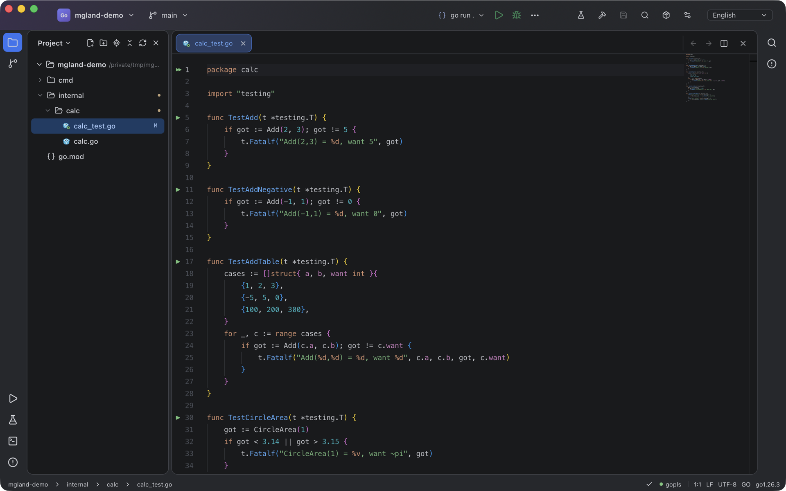
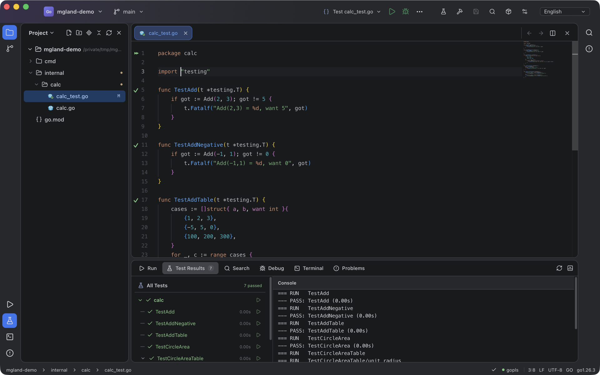
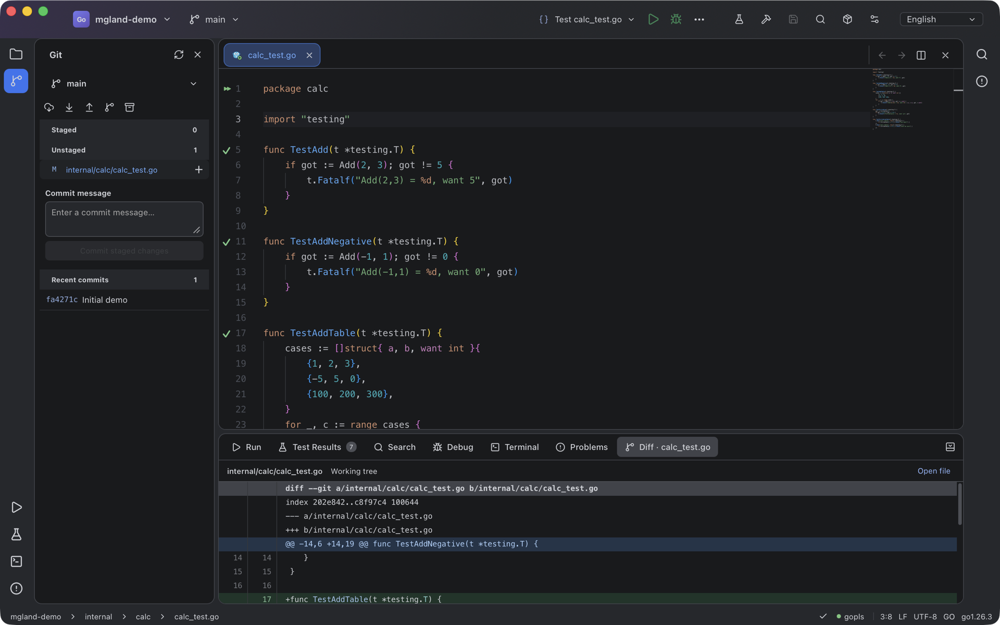
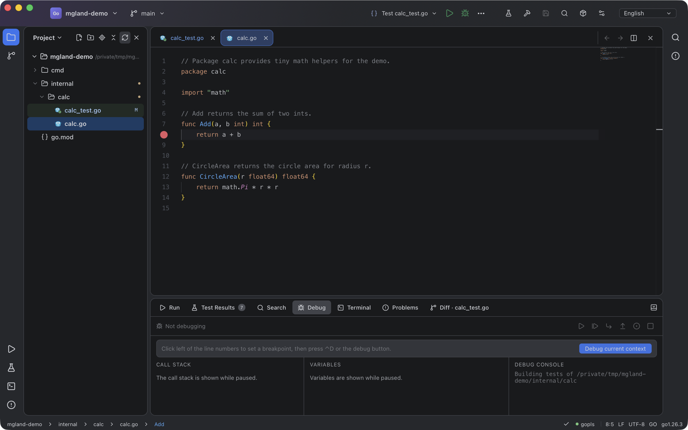
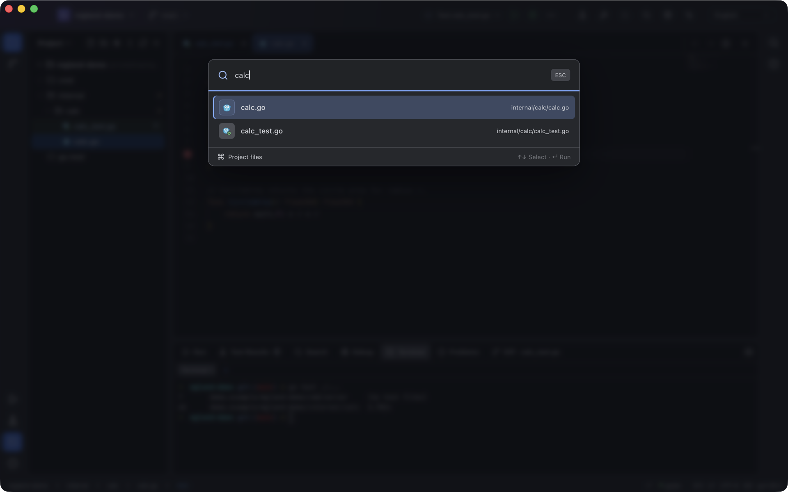
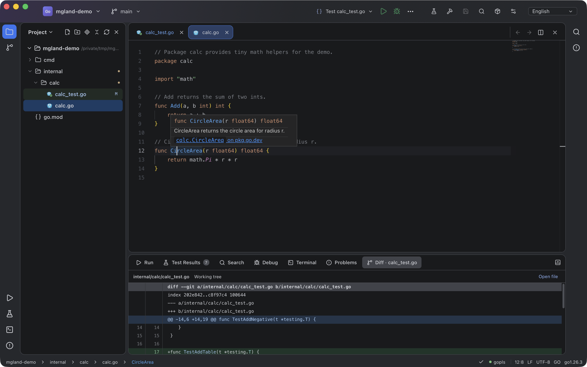
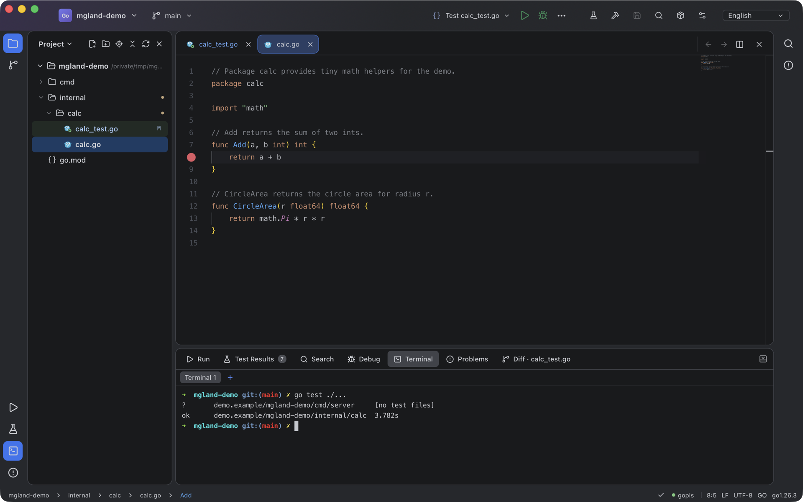

<div align="center">

# GoMavo

**专注于 Go 开发的 macOS 原生 IDE，基于 Go 官方工具链。**

Tauri 2 · React 19 · Monaco Editor · `gopls` · Delve



[English](README.md) | **简体中文**

</div>

GoMavo 是一个面向 macOS 的专注型 Go IDE：每个窗口打开一个项目，提供常用的 macOS 快捷键，底层使用官方 Go 工具链——`gopls` 提供语言服务，Delve 负责调试，运行与测试调用 `go` CLI。所有功能全部本地运行：没有账号、没有遥测、没有云。

## 特性速览

- **高效编辑体验**——Project 树（按 Git 状态着色）、多标签编辑、面包屑导航、双击 Shift 全局搜索、转到文件（⌘⇧O）、查找操作（⌘⇧A）、后退／前进并恢复光标与滚动位置。
- **真正的 Go 语言服务**——基于 `gopls` 的补全、悬停文档、诊断、语义高亮、跳转定义（Go SDK 与模块缓存以只读标签打开）和当前文件格式化。
- **内置 Delve 调试器**——点击 gutter 或按 F9 切换断点，⌃D 调试光标所在的测试或包；调用栈、变量与调试控制台都在 Debug 工具窗口中。
- **集成测试工作流**——`_test.go` 的 gutter 快速运行图标，⌃R 运行光标所在测试或整个文件，结果以用例树展示并支持单项重跑，附带测试覆盖率高亮（`go test -cover`）。
- **Git 工具窗口**——分支切换、已暂存／未暂存改动与统一差异视图、提交、近期历史、文件历史与逐行 blame。
- **一切本地化**——PTY 集成终端、`go mod tidy/download`、`go vet`、`go fmt`、`.editorconfig` 支持与原生插件系统。界面支持中文与 English。

<table>
  <tr>
    <td width="50%"><p align="center"><sub>从 gutter 运行测试；结果树支持单项重跑</sub></p></td>
    <td width="50%"><p align="center"><sub>Git 工具窗口与统一差异、提交框</sub></p></td>
  </tr>
  <tr>
    <td width="50%"><p align="center"><sub>断点与基于 Delve 的 Debug 工具窗口</sub></p></td>
    <td width="50%"><p align="center"><sub>转到文件浮层（⌘⇧O）</sub></p></td>
  </tr>
  <tr>
    <td width="50%"><p align="center"><sub>gopls 悬停文档</sub></p></td>
    <td width="50%"><p align="center"><sub>基于真实 PTY 的集成终端</sub></p></td>
  </tr>
</table>

## 环境与启动

从源码构建需要 Node.js、pnpm、Rust/Cargo 和 Go 工具链，桌面构建还需要满足当前操作系统的 Tauri 2 系统依赖；构建脚本会在打包前自动编译 `gopls` 与 `dlv`（Delve）并打入安装包。运行安装包只需本机装有 Go 工具链和 Git，请确认 `go version`、`git --version` 可用，`gopls` 无需单独安装。

应用优先使用安装包内置的 `gopls` 与 `dlv`，找不到时再从 `PATH`、`GOBIN`、`GOPATH/bin` 等位置查找。仍可打开项目后，通过右下角的状态栏安装或升级 `gopls`；此操作需要能够访问 Go 模块源。

```bash
pnpm install
pnpm tauri dev
```

启动后点击左上角项目名称，可选择「新建窗口」「新建项目」或「打开项目」；macOS 的 File → New Window、File → New → Project、File → Open Project 也提供入口，Dock 图标右键菜单可新建窗口。新窗口会显示项目选择页，可在其中打开已有项目或新建 Go 项目，不会自动打开上一项目。新建项目会在所选父目录创建文件夹，并执行 `go mod init`。已有项目的窗口中再打开或新建项目时，会启动独立窗口；每个窗口保留自己的项目状态。应用启动时会恢复上次打开的目录。macOS 应用菜单中的 Settings… 或 ⌘, 可打开设置。制作桌面安装包运行 `pnpm tauri build`。`pnpm dev` 只预览浏览器界面；文件、Go 命令、Git、PTY 终端和 `gopls` 依赖 Tauri 桌面后端。

## 已实现的工作流

| 领域 | 当前能力与入口 |
| --- | --- |
| 项目与文件 | Project 树浏览、定位当前文件、全部收起；文件和目录右键菜单可打开、新建、复制路径、重命名、删除，也可新建 `.editorconfig`；多标签编辑与保存；文件搜索。二进制文件可打开为只读十六进制预览。⌘S 保存当前文件，⌘⌥S 保存全部文件；关闭未保存的标签或窗口时会提示，保存时检查磁盘文件是否已被外部更改。 |
| Go 编辑 | `gopls` 提供补全、悬停信息、诊断、语义高亮、跳转定义和当前文件格式化；Problems 面板可定位诊断。⌘B 与 ⌘点击定义链接都可打开工作区外的 Go 定义，并以只读标签显示；范围限于 Go SDK、模块缓存和 Go 配置中的本地模块。代码跳转保存光标与滚动位置，可通过编辑器标签栏的后退／前进按钮或快捷键返回。 |
| 运行与测试 | 顶部运行配置可执行项目根包 `go run .`、当前文件所在包的 `go run`、全部/当前包/目录及子目录/文件中的测试，以及 `go build ./...`。测试使用 `go test -json -count=1`，在 Test Results 中显示包、测试用例和输出；可重跑单个测试或最近一次测试范围。Go 源文件可在项目树右键生成测试方法，编辑器内右键可针对当前方法或整文件生成测试桩，写入同目录的 `_test.go`；已有同名测试会跳过。`_test.go` 的 package 行与 Test、Example、Fuzz、Benchmark 声明旁可快速运行，方法 gutter 显示最近运行结果。「带覆盖率运行」收集 `go test -cover` 数据，并在编辑器中高亮覆盖／未覆盖代码。任务可停止。 |
| 调试 | 内置 Delve（DAP）：源文件 gutter 点击或 F9 切换断点；⌃D 调试光标上下文（所在测试方法、测试文件或包）；Debug 工具窗口提供调用栈（可切换栈帧）、变量查看、调试控制台与停止按钮。 |
| Go 工具与模块 | 顶部「更多 Go 操作」提供 `go fmt ./...`、`go vet ./...`、`go mod tidy`、`go mod download`；`go.mod`、`go.sum`、`go.work` 可作为文本文件打开和编辑。 |
| Git | Git 工具窗口展示分支、已暂存与未暂存状态；项目树与编辑器标签按文件状态着色。项目树文件和编辑器内右键可查看该文件的 Git 修改历史，点击提交可查看差异。也可查看当前文本差异、暂存/取消暂存、提交和近期提交，编辑器右键可按行查看 Git Blame。顶部可创建并切换本地分支。Git 功能需要本机 Git CLI 与打开的 Git 仓库目录。 |
| 终端 | Terminal 工具窗口以 xterm.js 和本机 PTY 运行项目目录中的 Shell，支持交互输入、窗口调整和会话结束后重启。 |
| 搜索与命令 | 双击 Shift 搜索文件和操作；另有 ⌘⇧O 转到文件、⌘⌥O 转到符号、⌘⇧F 在文件中查找、⌘E 最近文件。已启用的插件命令也出现在操作搜索中。 |
| 书签与本地历史 | F3 切换当前行书签；本地编辑历史按会话记录修改，可逐条查看差异。 |
| 插件 | 在「设置 → 插件」选择本地 `.gomavo-plugin` 安装包或 JSON 命令清单，可导入、启停和移除。原生插件可注册命令、Monaco 补全与悬停提示；JSON 清单只支持现有 Go 任务或打开项目内的相对路径文件。见下方的[原生插件说明](#gomavo-原生插件)和两个示例。当前没有在线插件市场。 |
| 设置 | 顶部齿轮、⌘, 或 macOS 应用菜单的 Settings… 打开设置；左侧分组树与搜索用于定位现有选项，包括紧凑模式、编辑器字号/行高/Tab/缩略图/换行、项目树、Git 自动刷新、终端字号、界面语言、快捷键及插件管理。偏好保存在本机应用存储中。主界面可切换中文与 English；部分新面板仍使用中文。 |

执行 Go 任务前会尝试保存已修改的标签。默认构建是 Go CLI 的 `go build ./...`，其输出行为遵循 Go 工具链，可能在项目目录生成文件。当前一次只运行一个 Go 任务。

## 与 GoLand 的对比

GoMavo 是独立开发的产品，与 JetBrains 没有关联或背书。下表仅用于说明工作流和功能差异；GoMavo 无法运行 JetBrains 插件。它使用 `gopls`、Delve 和 `go` CLI。

GoLand 是 JetBrains s.r.o. 的商标。参见 [JetBrains 品牌指南](https://www.jetbrains.com/company/brand/)。

**GoMavo vs GoLand vs VS Code（Go 扩展）**

| | GoMavo | GoLand | VS Code + Go |
| --- | --- | --- | --- |
| 语言引擎 | `gopls`（官方 LSP） | JetBrains 自研 Go 引擎 | `gopls` |
| 调试器 | Delve（应用内置） | 基于 Delve | Delve |
| 运行开销 | 原生窗口 + 系统 WebView 界面，无 JVM | 基于 JVM（通常 GB 量级） | Electron |
| 启动速度 | 秒级，无需启动 JVM | 数十秒 | 秒级 |
| 重构能力 | 基础（暂无重命名/提取） | 重命名、提取、内联等完整能力 | 经 `gopls` 支持重命名 |
| 插件体系 | 自有 `.gomavo-plugin` 格式 | IntelliJ Marketplace（JVM） | VSIX 市场 |
| 授权 | MIT（开源） | 非商用免费，商用需付费订阅 | 免费 |

**与 GoLand 的功能对照**——诚实快照；✅ 已实现，⚠️ 部分，❌ 缺失：

| 领域 | GoMavo | 备注 |
| --- | --- | --- |
| 项目树、多窗口多项目 | ✅ | 无 GoLand 项目模板与多模块工程模型 ❌ |
| 编辑：补全 / 悬停 / 诊断 / 语义高亮 / 格式化 | ✅ | 经 `gopls`；无 Quick Fix 与意图操作 ❌ |
| 导航：跳转定义、后退／前进 | ✅ | Find Usages ❌、符号重命名 ❌ |
| 测试：gutter 与上下文运行、结果树、重跑、覆盖率 | ✅ | 覆盖率细分子视图 ⚠️ |
| 调试：断点、调用栈、变量、调试控制台 | ✅ | 无条件断点、goroutine 视图、core dump ❌ |
| Git：状态着色、暂存、提交、历史、blame | ✅ | 无 changelist、行级暂存、合并界面 ⚠️ |
| 终端、`.editorconfig`、可搜索设置、中英文界面 | ✅ | |
| 运行配置 | ⚠️ | 无持久化配置、程序参数与环境变量界面 |
| JetBrains Marketplace / VS Code 扩展 | ❌ | 见[插件兼容性](#goland-与-vs-code-插件兼容性) |

针对 **GoLand 2026.1.1** 的逐项对照（哪些在实机验证过、哪些仅有代码实现）见 [docs/goland-parity.md](docs/goland-parity.md)。

## 项目代码样式

「设置 → 编辑器 → 代码样式」会把当前项目的 Go 风格覆盖值保存到 `.gomavo/code-style.json`。打开项目时，GoMavo 会把已有的 `.mgland/code-style.json` 复制到新路径，不删除旧文件；若两个项目文件均不存在，则迁移更早版本存于浏览器本地存储的覆盖值。保存时整理导入由 gopls 执行，顺序为标准库、第三方模块、匹配本地前缀的模块；非空分组之间保留一个空行，前缀可用逗号分隔。该顺序和空行规则由 gopls 定义，代码样式页面会展示规则及可编辑的本地前缀和保存动作。

在项目中创建或编辑 `.editorconfig` 后，GoMavo 会按文件路径合并项目根目录与子目录中的配置；更近的配置优先，`root = true` 会停止向上查找。支持 `indent_style`、`indent_size`、`tab_width`、`end_of_line`、`trim_trailing_whitespace` 和 `insert_final_newline`，也支持用 `unset` 恢复编辑器默认值。缩进设置会应用到打开的文件，换行和空白规则在保存时应用；保存 `.editorconfig` 后，已打开文件的缩进设置会刷新。搜索范围止于当前项目目录，文件仍按 UTF-8 读写。

```ini
root = true

[*]
end_of_line = lf
insert_final_newline = true
trim_trailing_whitespace = true

[*.go]
indent_style = tab
tab_width = 4
```

## GoMavo 原生插件

原生插件是 GoMavo 自己的 `.gomavo-plugin` ZIP 包，根目录**恰好**包含 `manifest.json` 和 `main.js` 两个文件；已有的 `.mgland-plugin` 安装包仍可导入。`main.js` 是单文件 JavaScript ES 模块，导出 `activate(context)`；可以另行导出 `deactivate()`。宿主为每个启用并激活的插件创建独立 Web Worker。插件通过 GoMavo 提供的 API 注册能力，不直接访问编辑器 DOM、Tauri 命令或 Node.js API。

可以直接导入 [`examples/native-hello.gomavo-plugin`](examples/native-hello.gomavo-plugin) 试用，源码位于 [`examples/native-hello`](examples/native-hello)。在「设置 → 插件」中选择原生插件并从磁盘导入安装包，然后打开 Go 文件，在操作搜索中执行「插件：Native Hello 打招呼」，或在编辑器中请求补全 `gomavohello`。同 ID 再导入会更新插件并保留启停状态；停用或移除会注销其命令、补全和悬停提示。

插件清单示例：

```json
{
  "id": "example.native-hello",
  "name": "Native Hello",
  "version": "1.0.0",
  "description": "示例原生插件：命令、Go 补全和悬停提示",
  "main": "main.js",
  "activationEvents": ["onLanguage:go", "onCommand:example.native-hello.greet"],
  "contributes": {
    "commands": [{ "command": "example.native-hello.greet", "title": "插件：Native Hello 打招呼" }]
  }
}
```

`activationEvents` 至少声明一项，支持 `onStartupFinished`、`onLanguage:<语言 ID>` 和 `onCommand:<命令 ID>`。`contributes.commands` 中声明的命令会进入操作搜索；执行时宿主会按需激活插件。命令处理器必须使用相同 ID 注册。

| `activate(context)` 中的接口 | 用途 |
| --- | --- |
| `context.commands.registerCommand(id, handler)` | 注册清单中声明的命令。 |
| `context.languages.registerCompletionItemProvider(language, provider)` | 注册 Monaco 补全。`provider` 可含 `triggerCharacters`，并须实现 `provideCompletionItems(document, position)`；返回 `{ label, insertText?, detail?, documentation?, kind? }[]`。 |
| `context.languages.registerHoverProvider(language, provider)` | 注册 Monaco 悬停提示。`provideHover(document, position)` 返回字符串或 `null`。 |
| `context.workspace.rootPath`、`onDidChangeWorkspace(listener)` | 获取当前项目目录并监听项目变化。 |
| `context.window.showInformationMessage(text)`、`showErrorMessage(text)` | 在应用中显示提示。 |
| `context.subscriptions` | 保存注册接口返回的 `dispose()` 对象，由宿主在停用时清理。 |

`document` 含 `uri`、`languageId` 和全文 `text`；`position` 的 `lineNumber`、`column` 从 1 开始。插件代码应打包为一个不依赖相对导入的 `main.js`。示例源码可重新打包：

```bash
cd examples/native-hello
zip -X ../native-hello.gomavo-plugin manifest.json main.js
```

安装包上限为 1 MiB，清单上限为 64 KiB，脚本上限为 512 KiB。Worker 隔离编辑器 API，但不是安全沙箱；插件代码仍可能使用浏览器网络能力，因此只安装可信的安装包。[`examples/go-workflow.gomavo-plugin.json`](examples/go-workflow.gomavo-plugin.json) 是单独的 JSON 命令清单格式，不运行自定义脚本，可在「设置 → 插件」中选择 JSON 命令并导入。

## GoLand 与 VS Code 插件兼容性

GoMavo 目前不能直接运行 JetBrains Marketplace 的 GoLand ZIP/JAR 插件。此类插件通过 IntelliJ Platform 的 JVM 类加载器、`plugin.xml` 扩展点和 IDE API 工作；使用 Go 专属 API 的插件还依赖 GoLand 与 `org.jetbrains.plugins.go`。GoMavo 的 Tauri、Monaco、`gopls` 宿主没有这些运行时接口。接入 Marketplace 的列表或下载接口也不会让插件可执行。参见 JetBrains 官方的[插件内容](https://plugins.jetbrains.com/docs/intellij/plugin-content.html)、[GoLand 插件开发](https://plugins.jetbrains.com/docs/intellij/goland.html)和[产品兼容性](https://plugins.jetbrains.com/docs/intellij/plugin-compatibility.html)说明。

VS Code 的 VSIX 扩展也不能直接安装：其 `package.json`、扩展宿主和 `vscode` API 与本项目的清单及 `context` API 不同。GoMavo 原生插件借鉴了 VS Code 的清单、激活事件和注册接口思路，但需要针对 GoMavo API 编写或移植代码。

可逐项迁移键位、主题等**数据**，或扩展 GoMavo 自己的插件能力；这两种方式都不等于兼容原版插件。若必须运行原版 GoLand 插件，需要以 IntelliJ Platform 为宿主重建 IDE，并逐个核对版本、依赖与插件许可。

## 默认快捷键

当前预设按 GoLand **macOS 默认键位**设计，和 GoLand 可选的 VS Code 键位不同。可在「设置 → 快捷键」重新录制、清除或恢复预设；系统保留的组合键可能无法被应用接管。

| 操作 | 默认键位 | 操作 | 默认键位 |
| --- | --- | --- | --- |
| 搜索所有内容 | 双击 ⇧ | 转到文件 | ⌘⇧O |
| 查找操作 | ⌘⇧A | 转到符号 | ⌘⌥O |
| 在文件中查找 | ⌘⇧F | 最近文件 | ⌘E |
| 跳转定义 | ⌘B | 后退 | ⌘⌥←（也支持 ⌘[） |
| 前进 | ⌘⌥→（也支持 ⌘]） | 切换书签 | F3 |
| Project | ⌘1 | Git | ⌘9 |
| Terminal | ⌥F12 | Run 输出 | ⌘4 |
| Problems | ⌘6 | Debug 工具窗口 | ⌘5 |
| 保存当前文件 | ⌘S | 保存所有文件 | ⌘⌥S |
| 运行上下文／当前配置 | ⌃R | 调试当前上下文 | ⌃D |
| 编译项目 | ⌘F9 | 停止任务 | ⌘F2 |
| 格式化当前 Go 文件 | ⌘⌥L | 打开设置 | ⌘, |
| 运行全部测试、带覆盖率运行、`go mod tidy` | 默认未绑定，可自行设置 |  |  |

在 `_test.go` 中，⌃R 会运行光标所在的 Test／Benchmark／Example／Fuzz 方法；光标不在方法内时运行当前测试文件，⌃D 则用 Delve 调试该上下文。其他文件仍运行顶部配置。测试方法也可从 gutter 或编辑器右键运行。Monaco 自身还提供编辑器内置操作；上表是 GoMavo 自己管理的默认键位。⌘⌥L 通过 `gopls` 格式化当前可编辑的 Go 文件；顶部「Go 工具 → 格式化代码」仍运行项目级 `go fmt ./...`。

生成的测试方法会用 `t.Skip("TODO: add test cases")` 标记待填写，补上用例后再运行即可。

## GoLand 参照与验证边界

开发时对 **GoLand 2026.1.1** 桌面版做过以下实机观察：

- 深色 Islands 外观、顶部控件与工具窗口结构。
- 在 `aidcanvas-backend` 项目中，F12 从 `image_gen_impl.go` 跳到项目内的 `internal/model/models_provider.go`；从 `ark.NewImageGenerationModel` 跳到 `~/go/pkg/mod/github.com/cloudwego/eino-ext/.../image_generation_model.go`。
- Settings 包含 Appearance & Behavior、Keymap、Editor、Plugins、Version Control、Build/Execution/Deployment、Languages & Frameworks 等分类；插件页提供 Marketplace 和本地安装入口。

这些是 **GoLand 侧的实机观察**。GoMavo 以自己的布局、`gopls` 桥接、设置和插件格式实现了对应工作流的一部分，不表示逐项兼容或达到同等深度。

本轮已在 macOS 桌面包中验证项目树文件点击、二进制预览、Git 文件状态颜色、`_test.go` 图标、Go 标准库定义跳转和 `gopls` 当前文件格式化。另用隔离的临时 Go 项目验证了包／方法 gutter 运行、⌃R 上下文运行、结果状态、单测及失败项重跑、整文件测试、单个 Benchmark、项目树收起／定位和 Git 标签颜色。本次继续验证了新建 Go 模块、独立窗口打开另一个项目、项目树右键新建和重命名，以及 `.editorconfig` 的缩进刷新和保存规则；详见[功能对照](docs/goland-parity.md)。新窗口项目选择页也在 macOS 调试包中验证：顶部入口和 ⌘N 均打开空白窗口，欢迎页可打开已有项目，点击新建项目可进入创建表单。Dock 右键入口已接入原生菜单，但自动化工具无法访问 Dock，尚未直接目视验证。其他工作流仍需在目标系统与具体 Go 项目中验证；浏览器预览和前端构建不能证明本机 Go、`gopls` 与 Git 工作流正常运行。

## 当前未覆盖

- JetBrains Marketplace、JVM ZIP/JAR 插件和 VS Code 扩展兼容。GoMavo 接受自己的 `.gomavo-plugin` 安装包和 JSON 命令清单。
- GoLand 的完整重构能力，例如跨项目符号重命名、提取方法及安全修改调用点。
- 调试高级功能：条件断点、goroutine 视图、core dump 分析。
- 图形化 Go 模块依赖管理和单窗口内的多工作区工程模型。模块操作目前调用 Go CLI；多项目通过独立窗口打开。
- 对任意工作区外文件的编辑；外部 Go 源码仅在允许的 Go 源目录内只读打开。

## 参与贡献

欢迎 Issue 与 PR。`pnpm test` 运行 Node 测试套件，`pnpm build` 做类型检查并打包前端。请保持 PR 聚焦，并说明你在桌面应用中验证过的工作流。

## 许可

本项目基于 [MIT 协议](LICENSE) 开源。

## 开源组件

[Tauri](https://tauri.app/) 提供桌面窗口和 Rust 本机后端，[Monaco Editor](https://microsoft.github.io/monaco-editor/) 提供编辑器，[gopls](https://go.dev/gopls/) 提供 Go 语言服务，[Delve](https://github.com/go-delve/delve) 提供调试器，[xterm.js](https://xtermjs.org/) 与 [`portable-pty`](https://docs.rs/portable-pty/) 提供集成终端。
